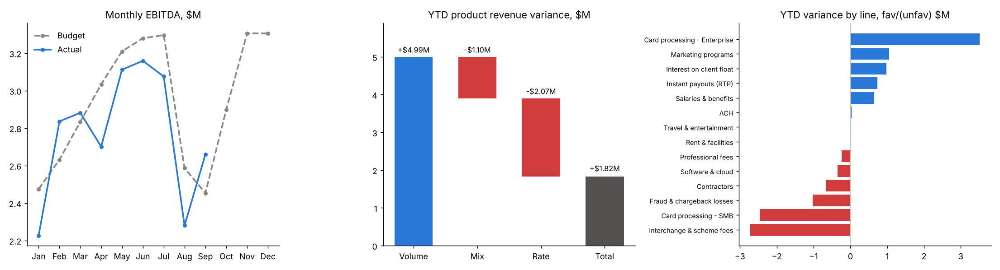

# Budget vs Actual Variance Pack

The monthly FP&A close deliverable for a card-payments company, built for the September 2026
close. It has three parts:

- **An Excel workbook driven by formulas.** P&L vs budget, opex by department, a revenue
  price/volume/mix bridge with a waterfall chart, a headcount and salary bridge, a full-year
  outlook and written commentary. Change the reporting month and every tab updates.
- **A web page** to explore the same numbers by month or year to date.
- **A pandas calculation**, and tests that check the recalculated workbook matches it line by line.

**[Open the interactive pack](https://martinogie.github.io/budget-variance-pack/)** ·
**[Download the Excel workbook](reports/FY2026_Budget_vs_Actual_Variance_Pack.xlsx)** ·
[Commentary](reports/COMMENTARY.md) ·
**[Tableau dashboard](https://public.tableau.com/app/profile/martins.ogiekpolor/viz/FY2026BudgetvsActualVarianceDashboard/FY2026BudgetvsActual)**

The Tableau Public dashboard is built from [tableau/budget_vs_actual.csv](tableau/budget_vs_actual.csv):
one row per month, department and P&L line, with budget, actual, Q4 forecast and a sign column
(+1 revenue, −1 cost) so EBITDA and favourable/unfavourable variance are simple calculated fields.



## September 2026 close

| $M | Sep actual | Sep budget | Fav/(Unfav) | YTD actual | YTD budget | Fav/(Unfav) | FY outlook | FY budget | Fav/(Unfav) |
|---|---|---|---|---|---|---|---|---|---|
| Revenue | 20.64 | 19.99 | +0.65 | 176.61 | 173.96 | +2.65 | 241.02 | 235.74 | +5.29 |
| Gross profit | 8.85 | 9.08 | (0.23) | 78.02 | 79.34 | (1.32) | 105.89 | 107.27 | (1.38) |
| Operating expenses | 6.19 | 6.63 | +0.44 | 53.09 | 53.54 | +0.45 | 72.75 | 71.96 | (0.78) |
| **EBITDA** | **2.66** | **2.45** | **+0.21** | **24.93** | **25.80** | **(0.87)** | **33.15** | **35.31** | **(2.16)** |

What the pack shows:

- **September's beat is timing.**
  - The Q3 marketing campaign moved to Q4, which saved $0.56M this month.
  - That saving hides a $0.23M gross-profit shortfall.
- **Revenue is ahead but margin is behind.** Product revenue is +$1.82M YTD:
  - **Volume +$4.99M**: more total payment volume.
  - **Mix −$1.10M**: volume shifted from SMB to lower-priced enterprise.
  - **Rate −$2.07M**: the enterprise take rate is 2.19% vs 2.25% in the budget.
  - As a result, gross margin is 44.2% vs 45.6% in the budget.
- **Engineering is 9 heads behind plan.**
  - Salaries are $0.51M favourable YTD: a headcount effect of +$0.82M, partly offset by a
    cost-per-head effect of −$0.32M.
  - Contractors are $0.67M over budget, backfilling the open roles.
- **The August card-testing attack** added $0.85M of fraud losses. Fraud is $1.02M unfavourable YTD.
- **Full-year EBITDA outlook is $33.15M**, $2.16M (6.1%) below budget. The commentary lists four actions.

## The workbook

| Tab | What it does |
|---|---|
| Control | Reporting month (yellow input), flag thresholds ($50K and 5%), guide and colour legend |
| P&L Summary | Month, YTD and full year: actual, budget, Fav/(Unfav) $ and %, margin rows, conditional-format flags |
| Dept Opex | Six departments × accounts, for the month and YTD, with department totals and flags |
| Revenue Bridge | Volume / mix / rate by product for the month and YTD, a check column, and a waterfall chart |
| Headcount | Budget vs actual headcount; salary variance split into a headcount effect and a cost-per-head effect |
| Forecast | Q4 method per line (run-rate or budget), $ adjustments as inputs, FY outlook vs budget |
| Commentary | Written September close notes and actions |
| GL_Data, Drivers, HC_Data | Source data: GL by month, department and line; payment volume and take rates; headcount |

The workbook has 937 formulas, mostly SUMIFS over the GL extract, and no hard-coded results.
Recalculating it in LibreOffice gives zero formula errors. It follows standard modelling
conventions: blue inputs, black formulas, green links between tabs, and favourable variances
shown as positive.

## Method

| Analysis | Formula |
|---|---|
| Fav/(Unfav) | Revenue: actual − budget. Cost: budget − actual |
| Volume effect (product *i*) | (total actual TPV − total budget TPV) × budget mix*i* × budget rate*i* |
| Mix effect | (actual TPV*i* − total actual TPV × budget mix*i*) × budget rate*i* |
| Rate effect | actual TPV*i* × (actual rate*i* − budget rate*i*) |
| Headcount effect | (budget − actual head-months) × budget cost per head |
| Q4 forecast | Q4 budget × (Q3 actual ÷ Q3 budget), or Q4 budget, + adjustment |

For every product, volume + mix + rate equals the actual revenue variance exactly. The
workbook's check column and the tests confirm this.

## Quick start

```bash
pip install -r requirements.txt
python -m budget_pack.run --recalc        # data, analysis, workbook (recalculated with LibreOffice), chart, page
python -m unittest discover -s tests      # 9 tests, including workbook vs pandas
```

Without LibreOffice, leave out `--recalc`; Excel calculates the workbook when it is opened.

## Layout

```
budget_pack/data.py       synthetic FY2026 budget and Jan-Sep actuals from volume, rate and headcount drivers
budget_pack/analysis.py   P&L variances, department opex, price/volume/mix, headcount bridge, Q4 forecast
budget_pack/workbook.py   formula-driven Excel pack (openpyxl)
budget_pack/run.py        pipeline, commentary, chart and web page
web/template.html         web page template (run.py writes index.html)
reports/                  the workbook, commentary, P&L summary and GL extract
```

## Data note

All data is synthetic. The budget and actuals are built from the same drivers (payment volume
by product, take rates, headcount and cost per head), with known stories added: enterprise
wins, an SMB slowdown, faster instant-payout adoption, higher interest rates, a fraud attack,
a hiring lag, a deferred campaign and compliance work. Each variance can therefore be traced
to its cause.

## How this was built

Built with AI-assisted coding (Claude). The analysis, structure and review are my own.

## License

MIT
